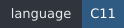
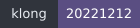
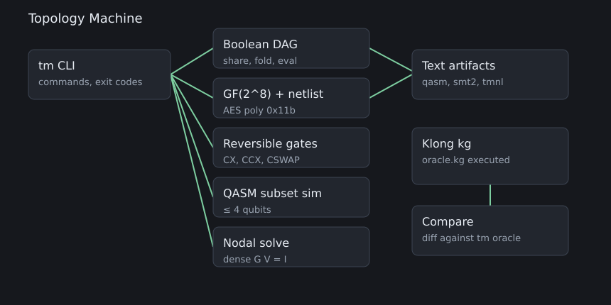
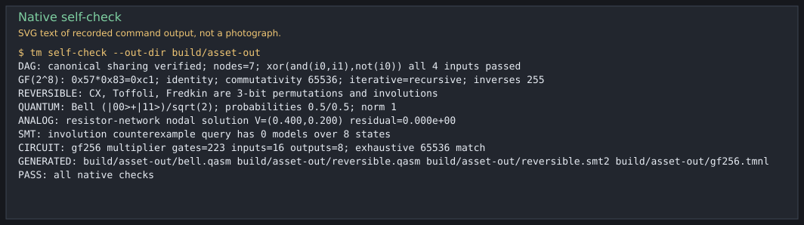
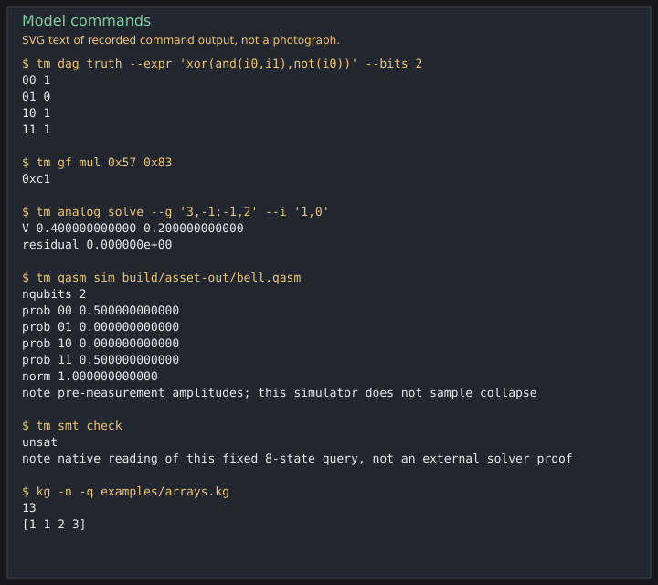
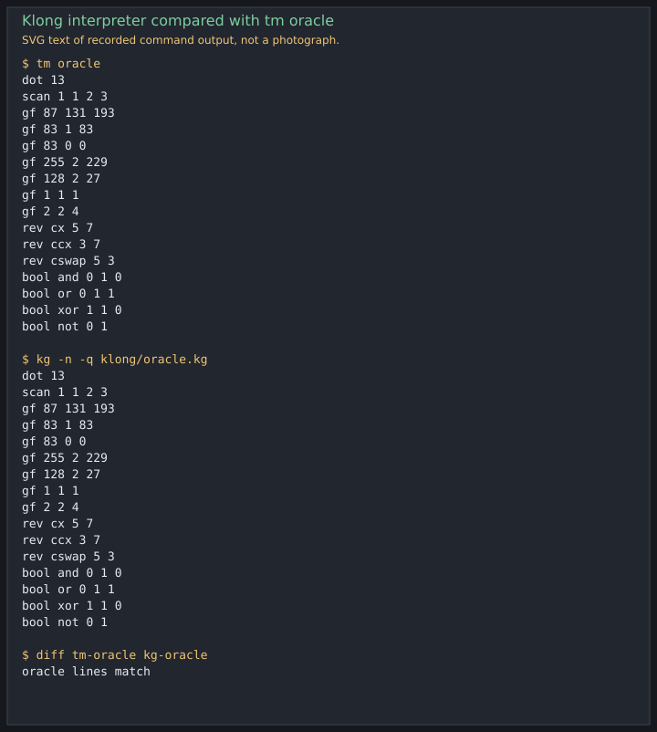
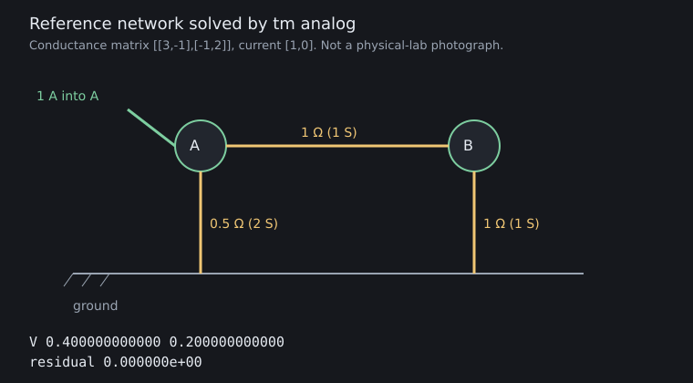
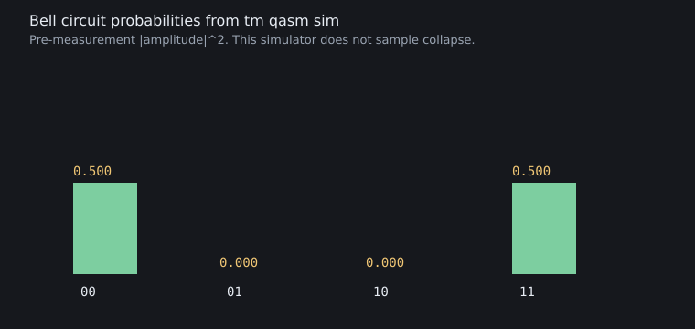
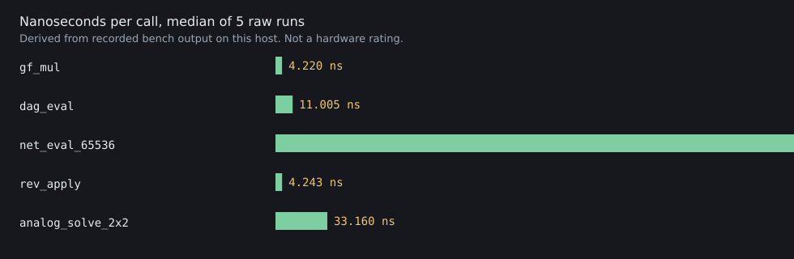
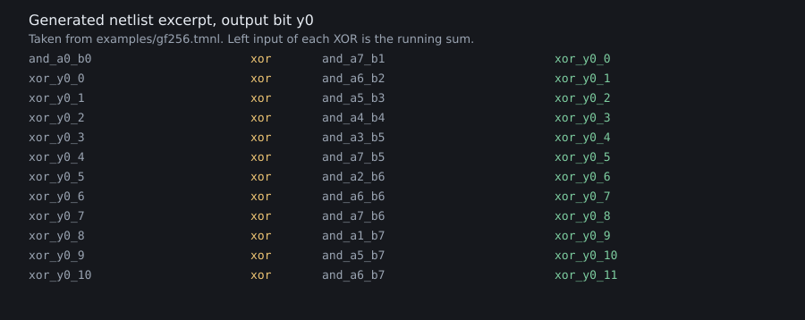

# Topology Machine





[](https://github.com/AHMADALIPARR/topology-machine/actions/workflows/ci.yml)

Topology Machine is a local workbench for a few finite mathematical models that show up together in circuit descriptions: a Boolean DAG, a GF(2^8) multiplier and its gate netlist, reversible CX / Toffoli / Fredkin gates, a two-qubit Bell state with an OpenQASM 3 subset simulator, and a small dense nodal (resistor-network) solve. A vendored Klong interpreter runs the same numeric examples and is diffed against the C program.

It is not a complexity-class separation, a quantum computer, a P/poly construction, or a physical energy experiment. Each model is finite, and the checks below say exactly what they cover.

The public repository is [AHMADALIPARR/topology-machine](https://github.com/AHMADALIPARR/topology-machine).

```sh
git clone https://github.com/AHMADALIPARR/topology-machine.git
cd topology-machine
make test
```

The badge above is GitHub's own status image for [`.github/workflows/ci.yml`](https://github.com/AHMADALIPARR/topology-machine/actions/workflows/ci.yml). It shows the latest hosted conclusion. The offline label in `assets/badges/ci.svg` says "not yet run" because that SVG is generated in the tree and is not a live Actions result.



## What the pictures are

The panels below are SVG text and diagrams drawn from commands run in this tree. The transcript SVGs copy the lines saved in `assets/transcripts/`. They are not photographs and they do not embed PNG data.















Regenerate them, after `make` and `make bench`, with `make assets`. That step needs Python 3 only. The standard library writes the SVG.

## Models

1. **Boolean DAG.** Nodes are shared when the operator and both children match. AND, OR, and XOR sort their children. Local rules: `x AND x = x`, `x OR x = x`, `x XOR x = 0`, constant folding through 0 and 1, and `NOT(NOT(x)) = x`. This is not e-graph saturation. An earlier starter returned node 1, the constant ONE, for `XOR(x,x)`. That identity is 0, and the regression test locks the correction.
2. **One finite GF(2^8) multiplier.** The polynomial is the AES polynomial `x^8 + x^4 + x^3 + x + 1` (reduction constant `0x1b`). The netlist is that one 8-bit circuit. It is not a nonuniform family and it is not “all of P/poly”.
3. **Reversible gates.** CX, Toffoli (CCX), and Fredkin (CSWAP) on a declared width. One of those gates is an involution. A sequence is a permutation of the `2^width` states; it is reversible, and it is not automatically an involution.
4. **Quantum, in the small sense.** H on qubit 0 and CX into qubit 1, starting from `|00>`, with qubit 0 as the least significant bit, produces `(|00> + |11>) / sqrt(2)` with positive real amplitudes. The OpenQASM 3 file is simulated by a subset interpreter of at most 4 qubits. Measurement is not sampled. This is not a device and not a BQP result.
5. **Analog.** Dense real solve of `G V = I` by Gauss-Jordan with partial pivoting, at most 16 nodes. The reference network is the conductance matrix `[[3,-1],[-1,2]]` with current `[1,0]`. A pivot below `1e-12` is reported as singular. The solver does not check passivity, and it does not model settling time.
6. **Klong.** `examples/arrays.kg` and `klong/oracle.kg` are real Klong, executed by Nils M Holm’s interpreter. The C program prints the same lines. Klong is not wired in as a compiler backend.

## Layout

| Path | Role |
| --- | --- |
| `src/`, `include/tm.h` | C11 library and `tm` CLI |
| `klong/oracle.kg` | Klong script compared with `tm oracle` |
| `examples/` | Array script, demo script, generated GF netlist |
| `third_party/klong/` | Klong 20221212, public domain / CC0, unmodified license |
| `tests/` | C tests, CLI and install scripts, golden QASM and SMT |
| `bench/results/` | Raw timings and the Z3 transcript |
| `assets/` | Figures. Transcripts live in `assets/transcripts/` |
| `scripts/regen_assets.py` | Rebuilds the figures |

## Requirements

- A C11 compiler and `make`. `libm` is linked.
- For `make test-san`, a compiler that can link ASan and UBSan. On this image `cc` is Clang without compiler-rt, so the sanitizer target uses `gcc` (`SAN_CC=gcc`). Override `SAN_CC` if you need a different compiler.
- Optional: Z3, Bitwuzla, or Boolector, to read `tests/golden/reversible.smt2`.
- Optional, for figures: Python 3. `make assets` writes SVG only.

No network service, account, or package registry is required to build or test.

## Build, test, install

```sh
make            # build/tm and third_party/klong/kg
make test       # unit tests, Klong diff, CLI, staged install
make test-san   # same unit tests under ASan and UBSan
make verify     # make test, then z3, bitwuzla, or boolector if one is on PATH
make bench      # five raw timing runs in bench/results/
make assets     # figures from those outputs
make install PREFIX=/usr/local
make uninstall PREFIX=/usr/local
```

`./scripts/bootstrap.sh` checks for `cc`, `make`, and `diff`, restores the two non-UTF-8 Klong files, then builds. `make`, `make test`, and `make install` run that same restore, so a clean clone can use those targets directly. `./scripts/fetch-klong.sh` re-downloads `klong20221212.tgz` and checks SHA-256 `5e1a4877228a3c643a99dbfd2d73e60bc3fa856e2615ac2fe78c80370e7f96b4`. It does not replace the vendored tree.

Install layout, under `PREFIX`:

| Path | File |
| --- | --- |
| `bin/tm` | CLI, statically linked with the library |
| `bin/tm-kg` | Wrapper around the Klong interpreter |
| `libexec/tm-kg.bin` | Upstream `kg` |
| `lib/libtm.a`, `lib/pkgconfig/tm.pc` | Library |
| `include/tm.h` | API |
| `share/man/man1/tm.1` | Manual page |
| `share/topology-machine/` | Klong scripts, examples, upstream `lib/*.kg` |

`tm-kg` finds `libexec` and the Klong library relative to its own `bin/` directory, so a `DESTDIR` staging tree works before it is moved onto the final prefix.

## Klong

The interpreter is [Klong 20221212](https://t3x.org/klong/) by Nils M Holm. Its license file says nobody owns that code and, where a public domain is not recognized, CC0 applies. Those terms are not replaced by the AGPL. See `third_party/KLONG.md`.

```sh
make klong
third_party/klong/kg -n -q examples/arrays.kg
third_party/klong/kg -n -q klong/oracle.kg
./build/tm oracle
```

`examples/arrays.kg` prints:

```text
13
[1 1 2 3]
```

That is the dot product of `[1 2 4 8]` with `[1 0 1 1]`, and the prefix sums of the second list. A non-interactive `kg` run does not echo bare expressions, so the script prints them.

`klong/oracle.kg` also multiplies in GF(2^8) with the same AES reduction, as 8-bit vectors, and applies CX, Toffoli, and Fredkin on the same wires as the C demo. `make test` diffs that output with `tm oracle`. The diff is empty. The Klong field check is this fixed vector list, not the C program’s exhaustive 65536-pair sweep.

## Quickstart

From a built tree:

```sh
./build/tm self-check --out-dir out
./build/tm dag truth --expr 'xor(and(i0,i1),not(i0))' --bits 2
./build/tm gf mul 0x57 0x83
./build/tm gf inv 0x57
./build/tm rev apply --width 3 --state 5 --prog 'cx 0 1; ccx 0 1 2'
./build/tm analog solve --g '3,-1;-1,2' --i '1,0'
./build/tm qasm sim out/bell.qasm
./build/tm smt check
third_party/klong/kg -n -q examples/arrays.kg
```

Recorded output of `tm self-check --out-dir build/asset-out`:

```text
DAG: canonical sharing verified; nodes=7; xor(and(i0,i1),not(i0)) all 4 inputs passed
GF(2^8): 0x57*0x83=0xc1; identity; commutativity 65536; iterative=recursive; inverses 255
REVERSIBLE: CX, Toffoli, Fredkin are 3-bit permutations and involutions
QUANTUM: Bell (|00>+|11>)/sqrt(2); probabilities 0.5/0.5; norm 1
ANALOG: resistor-network nodal solution V=(0.400,0.200) residual=0.000e+00
SMT: involution counterexample query has 0 models over 8 states
CIRCUIT: gf256 multiplier gates=223 inputs=16 outputs=8; exhaustive 65536 match
GENERATED: build/asset-out/bell.qasm build/asset-out/reversible.qasm build/asset-out/reversible.smt2 build/asset-out/gf256.tmnl
PASS: all native checks
```

`0x57 * 0x83 = 0xc1` is the AES test vector. `tm gf inv 0x57` prints `0xbf`. The truth table of `xor(and(i0,i1),not(i0))`, with `i0` the least significant bit, is `00 1`, `01 0`, `10 1`, `11 1`. The reference nodal solution is `V 0.400000000000 0.200000000000` with residual `0.000000e+00`. The Bell simulation prints probability 0.5 on `00` and `11`, and 0 on `01` and `10`.

`./examples/demo.sh` runs that path. `TM` and `OUT` override the binary and the output directory.

## CLI

`man tm` after install, or `tm help`. Exit status: 0 success, 1 a check failed, 2 usage or malformed input, 3 I/O, 4 domain (singular matrix, missing field inverse, illegal wire).

| Command | Effect |
| --- | --- |
| `tm self-check [--out-dir DIR]` | Native bundle. Writes QASM, SMT-LIB, and the GF netlist. |
| `tm oracle` | Decimal lines that `klong/oracle.kg` must match. |
| `tm bench` | One sample of each kernel. `make bench` repeats it five times. |
| `tm dag eval --expr E --input N` | One bit. |
| `tm dag truth --expr E [--bits N]` | Truth table. `--bits` is at most 16. |
| `tm gf mul A B` / `inv A` / `pow A EXP` | Bytes, decimal or `0x` hex. |
| `tm gf check [--full]` | 65536 products. `--full` adds all 16777216 associativity and distributivity triples. |
| `tm gf circuit --out FILE` | Writes the netlist after checking all 65536 products. |
| `tm rev apply --width N --state S --prog P` | `cx`, `ccx`, `cswap` with decimal wires. |
| `tm rev check` | The three 3-bit demo gates. |
| `tm qasm bell\|reversible --out FILE` | Exact starter texts. |
| `tm qasm sim FILE` | Subset simulator. |
| `tm analog solve --g ROWS --i VALUES` | Rows separated by `;`, entries by `,`, C locale. |
| `tm smt involution --out FILE` | Writes the fixed QF_BV query. |
| `tm smt check` | Reads that query over all 8 states. Prints `unsat` when no counterexample exists. |

Integers are decimal or `0x` hex. `0b` is rejected.

## Library

`include/tm.h` is the C API. Node indices are nonnegative; index 0 is the constant 0, and errors are negative (`tm_strerror`). The DAG holds at most 4096 nodes and 64 inputs. The netlist evaluator packs at most 64 inputs and 64 outputs into `uint64_t`. The QASM simulator accepts at most 4 qubits. The nodal solver accepts 1 to 16 rows.

The calls used by the CLI are `tm_dag_*`, `tm_expr_*`, `tm_gf_*`, `tm_net_*`, `tm_rev_*`, `tm_q_*`, `tm_qasm_*`, `tm_analog_solve`, `tm_smt_*`, `tm_oracle_write`, `tm_selfcheck`, and `tm_bench_run`. Link `libtm.a` with `-lm`. The library does not allocate in `tm_gf_mul` or `tm_dag_eval`.

## Data formats

Full notes are in [docs/FORMATS.md](docs/FORMATS.md).

**Expressions.** `0`, `1`, `i0`, `not(e)`, `and(e,e)`, `or(e,e)`, `xor(e,e)`. Whitespace is allowed. `i0` is the least significant input bit.

**Netlist version 1.** Comments start with `#`. The first statement is `tm-netlist 1`. Then `input`, `const 0|1`, `and`, `xor`, `not`, and `output`. A name refers only to an earlier gate. `examples/gf256.tmnl` is the multiplier: 16 inputs `a0..a7`, `b0..b7`, 8 outputs `y0..y7`, 223 gates. `y0` is the least significant product bit. The file is regenerated by `tm gf circuit` and diffed in `tests/integration.sh`.

**OpenQASM.** The writer emits the starter Bell and reversible texts byte for byte (`tests/golden/`). The simulator accepts `OPENQASM 3.0`, `include`, one `qubit[n]` register, `bit[n]`, `h`, `x`, `cx`, `ccx`, `cswap`, and trailing `c[k] = measure q[j]`. A gate after a measure is an error. Measures do not change the returned state vector.

**SMT-LIB.** `tests/golden/reversible.smt2` is the starter QF_BV query, including the unused names `a`, `b`, and `c`. The assertion is true of a state when any of the three gates fails to be an involution. `unsat` means no such 3-bit state exists. It does not certify the rest of this repository.

**Oracle lines.** `dot`, `scan`, `gf`, `rev`, and `bool` records, decimal, so Klong’s printer and `tm oracle` match without a hex formatter.

**Bench.** `name ops seconds ns_per_op`, repeated under `# run N` in `bench/results/bench-runs.txt`.

## Benchmarks

Reproduction:

```sh
make bench
```

That writes `bench/results/environment.txt` and five raw samples in `bench/results/bench-runs.txt` (also copied to `bench/results/bench.txt`). The chart uses the median of `ns_per_op`. These are wall-clock samples of this process. The default build does not enable LTO, so the bench file calls into the library. They are not a statistical study and not a hardware rating.

Recorded host, from `bench/results/environment.txt`:

```text
tm 1.0.0
date_utc 2026-11-07T07:09:02Z
Linux 6.12.113+ x86_64
Ubuntu clang version 18.1.3 (1ubuntu1)
cflags -std=c11 -O2 -Wall -Wextra -Werror -pedantic
runs 5
model name	: Intel(R) Xeon(R) Processor
```

Raw run 1:

```text
name ops seconds ns_per_op
gf_mul 2097152 0.008850907 4.220
dag_eval 200000 0.002155161 10.776
net_eval_65536 65536 0.021795706 332.576
rev_apply 600000 0.002520049 4.200
analog_solve_2x2 50000 0.001658021 33.160
sink 295465600
```

Medians of the five `ns_per_op` samples: `gf_mul` 4.220, `dag_eval` 11.005, `net_eval_65536` 331.744, `rev_apply` 4.243, `analog_solve_2x2` 33.160. The netlist walk is slower per call because each of the 65536 evaluations steps through 223 gates. `sink` is a volatile accumulator so the calls are not deleted.

## Tests and the verification boundary

`make test` runs, and on the 2026-11-07 build all of these passed:

| Check | What it actually does |
| --- | --- |
| `tests/test_dag` | Sharing, the XOR-zero correction, constant rules, capacity, and evaluation after the DAG is full |
| `tests/test_expr` | Rejects malformed expressions, fuzzes 200 random strings, and compares 100 random trees with the DAG on all 8 inputs of 3 bits |
| `tests/test_gf` | AES vector, all 65536 products for commutativity and iterative-versus-recursive, all 255 inverses, and all 16777216 associativity and distributivity triples |
| `tests/test_circuit` | All 65536 netlist evaluations against `tm_gf_mul`, a write/read round trip, and malformed netlists |
| `tests/test_rev` | Permutation and involution for every legal wire choice on widths 1..4 for CX and on 3 bits for Toffoli and Fredkin; a two-CX sequence is a permutation and not an involution |
| `tests/test_quantum` | Bell amplitudes, golden QASM bytes, subset simulation, X, missing file, and a gate after measure |
| `tests/test_analog` | The 2-node reference, a 3-node ladder (`0.75, 0.5, 0.25`), a nonsymmetric 2×2, singular and non-finite input, and 20 diagonally dominant systems |
| `tests/test_smt` | Golden SMT bytes, zero counterexample states, and formula-versus-native agreement on all 8 states |
| `tests/test_oracle` | The decimal oracle matches the C operations |
| Klong | `kg -n test.kg` prints `ok!`. `klong/oracle.kg` matches `tm oracle`. `examples/arrays.kg` prints `13` and `[1 1 2 3]` |
| CLI | Usage, parse errors, singular matrix, bad wires, missing file |
| Install | `DESTDIR` install, `tm version`, `tm-kg` on the oracle, uninstall |
| ASan / UBSan | The same unit tests and `tm self-check`, with `gcc -fsanitize=address,undefined -fno-sanitize-recover=undefined` |

Z3 4.8.12, reading `tests/golden/reversible.smt2`, printed `unsat`. The transcript is `bench/results/z3-involution.txt`. Bitwuzla and Boolector were not installed here. `make verify` runs whichever of the three is first on `PATH`. An external `unsat` certifies that query text. It does not certify the C evaluator, except that the unit test also checks the same bit operations against the native gates for every 3-bit state.

Not verified, and not claimed:

- OpenQASM semantics beyond the subset above, and any quantum device.
- A general SMT solver inside this repository. The native reading enumerates 8 states of one query.
- Klong agreement outside the oracle vectors.
- Passivity, conditioning far from the `1e-12` pivot cutoff, or any physical thermal claim. Reversible gates avoid a logically necessary erasure; they do not bound laboratory switching energy.
- The benchmark as a stable cross-machine number. Re-run `make bench` on the machine you care about.

## Limitations and security

This program does not open sockets, capture packets, or change interface state. The notes that accompanied the starter also contained a raw packet-capture daemon, an interface shutdown, an `O_APPEND` log described as WORM, and a toy GF “MAC”. Those are not in this tree. `O_APPEND` is not a write-once archive, and that toy construction is not a MAC. Details and the conflict with building such a daemon are in [docs/REFERENCE_BOUNDARY.md](docs/REFERENCE_BOUNDARY.md) and [SECURITY.md](SECURITY.md).

Other limits worth repeating: the DAG’s rules are the local ones listed above; the multiplier is one circuit; the QASM simulator stops at 4 qubits and does not sample measurement; the linear solver is a small dense routine.

## AGPL-3.0-only

Topology Machine source, scripts, and project configuration are AGPL-3.0-only. The license text is `LICENSE`. Copyright 2026 Topology Machine contributors. No individual author name is assigned beyond that, because the starter archive did not name one.

If you modify this program and let users interact with it remotely over a network, AGPL section 13 requires you to offer those users the corresponding source of your version. The CLI as shipped does not listen on a network. Wrapping it in a service does not remove that duty.

The Klong interpreter and S9core stay under their own public-domain / CC0 terms. Do not strip `third_party/klong/LICENSE` or `third_party/klong/CC0`.

## Development

See [CONTRIBUTING.md](CONTRIBUTING.md). Bugs and security reports are described in [SECURITY.md](SECURITY.md).

GitHub Actions for [AHMADALIPARR/topology-machine](https://github.com/AHMADALIPARR/topology-machine) is `.github/workflows/ci.yml`. It defines three jobs: `build, test, Klong` (`make test`), `sanitizers` (`make test-san`), and `solver` (Z3 on the emitted involution query, which must print `unsat`). Hosted run [42352065871](https://github.com/AHMADALIPARR/topology-machine/actions/runs/42352065871) on `936521bc` failed `make test` while compiling `tests/test_expr.c` (`-Werror=format-truncation`). The generator now copies into a checked buffer. The Actions badge is the live result; `assets/badges/ci.svg` stays the offline "not yet run" label.
